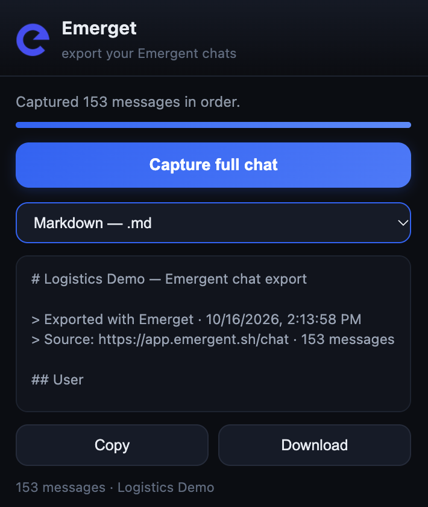

<div align="center">


# Emerget: Export Emergent Chat History

**Download your complete [Emergent](https://app.emergent.sh) conversations as Markdown, TXT, JSON, or a resume prompt — in one click.**

[](https://developer.chrome.com/docs/extensions/)
[](LICENSE)
[](#development)

[Get the source](https://github.com/vishxl/emerget) · [Report a bug](https://github.com/vishxl/emerget/issues) · [Request a feature](https://github.com/vishxl/emerget/issues)

</div>

---

Emerget is a Chrome extension that exports the **entire conversation** from an Emergent.sh chat — every user prompt, every assistant response, every tool action — in the same order you see in the app.

Emergent's chat UI virtualizes its message list and collapses long content ("Show more"), so manually copying a conversation gives you fragments in the wrong order. Emerget talks to Emergent's own timeline API instead: it paginates the full event history server-side and renders it faithfully. No scrolling marathon, no copy-paste across hundreds of messages, no lost turns.

<p align="center">
  
</p>

## Features

- **Complete history** — the timeline API returns every event since the chat began; virtualization and collapse toggles are irrelevant
- **Chronologically ordered** — events are reversed from newest-first API order into true conversation order
- **Faithful rendering** — user inputs stay separate turns; assistant messages, tool tiles ("Viewing 6 paths", "Reading logs: tail -20 …") and delegation notes appear just as the UI shows them
- **Smart deduplication** — terminal events (`AssistantFinalText`, `AgentFinished`) that repeat the turn's last message are detected and dropped, so nothing appears twice
- **Branded exports** — every file opens with the project's real name (fetched from Emergent's own API), source URL, export date, message count, and `[USER]`/`[ASSISTANT]` labels; the filename carries it too
- **Four export formats** — plain transcript (`.txt`), Markdown (`.md`), raw JSON, and a **resume prompt** you can paste into a new chat to continue where you left off
- **Private by design** — the session token never leaves your browser; every request goes to Emergent's own API from your own logged-in tab. No external servers, no analytics, no accounts.

## Install

1. Download the repository (**Code → Download ZIP**), or clone it:
   ```bash
   git clone https://github.com/vishxl/emerget.git
   ```
2. Open `chrome://extensions` in Chrome (or `edge://extensions` in Edge)
3. Enable **Developer mode** (top right)
4. Click **Load unpacked** and select the `emerget/` folder — the one containing `manifest.json`
5. Pin the extension to your toolbar

No account or API key — you just need to be signed in to Emergent in the same browser.

## How to export an Emergent conversation

1. Open the [Emergent chat](https://app.emergent.sh) you want to export
2. Click the Emerget icon
3. Click **Capture full chat** — a few seconds, even for very long chats
4. Choose a format, then **Copy** or **Download**

| Format | Best for |
|---|---|
| Transcript (`.txt`) | Reading; mirrors the app's own layout with timestamps |
| Markdown (`.md`) | Notes, wikis, GitHub gists — headers per turn |
| JSON | Archiving, re-import, custom tooling |
| Resume prompt | Pasting into a fresh Emergent chat to pick up where you left off |

## How it works

```
popup ──capture──▶ content script (emergent.sh tab)
                      │  1. read Supabase session token (localStorage)
                      │  2. GET /__backend/jobs/v0/<id>/        → project name
                      │  3. GET /__backend/v1/jobs/<id>/timeline?flags&older_than=…
                      │     (paginated with older_than cursor until exhausted)
                      │  4. reverse → chronological, map events → turns
                      ▼
                  chrome.storage.local ──▶ popup renders / copy / download
```

Emergent's timeline is a stream of typed events (`InputReceived`, `AssistantText`, `AssistantFinalText`, `ToolCallStart`, `AgentFinished`, …). Emerget maps them to a simple `{role, text, timestamp}` list:

| Event | Rendered as |
|---|---|
| `InputReceived` | **User** turn (one per input — never merged) |
| `AssistantText` | **Assistant** turn (every block kept) |
| `AssistantFinalText` / `AgentFinished` | kept only when they add text beyond the turn's last block |
| `ToolCallStart` | assistant tool line, using the UI's own tile label |
| `Thinking`, `Step*`, `Task*`, `ToolCallResult` | skipped (bookkeeping) |

The session token is read from your logged-in tab's own localStorage and sent only to `app.emergent.sh`. Emerget requests no extra permissions beyond that one host.

## Compatibility and troubleshooting

- Built against the Emergent UI/API as of early 2026 (chat v3 experience)
- If capture starts failing after an Emergent update: reload the Emergent tab, reload Emerget from `chrome://extensions`, and pull the latest version of this repo — the capture engine is a small, well-documented module that's easy to re-point
- Still stuck? [Open an issue](https://github.com/vishxl/emerget/issues) with the error you see — **strip session tokens and private conversation content before sharing logs**

## Privacy

Emerget has no backend. It reads your session token from the page you're logged into, calls Emergent's own endpoints, and stores the result in your browser's local extension storage. Nothing is transmitted anywhere else. Removing the extension removes all stored exports.

Exports are plain files on your disk — check them for private prompts, credentials, or customer data before sharing.

## Development

```
emerget/
├── manifest.json        # MV3, scoped to app.emergent.sh only
├── inject.js            # records the job ids the page requests (main world)
├── content.js           # capture engine: auth → timeline pagination → renderer
├── popup/
│   ├── popup.html       # UI
│   └── popup.js         # formats, progress, copy/download
├── icons/               # extension icons
└── test/
    ├── events.test.mjs      # event → transcript renderer
    └── formatters.test.mjs  # export formats
```

Run the tests (plain Node, no dependencies):

```
node --test test/
```

Load the unpacked extension, reload after edits, and use the popup's JSON format to inspect what a capture produced when debugging.

## FAQ

### Can I download my Emergent chat history?

Yes — open the conversation, click **Capture full chat**, and download it as Markdown, TXT, JSON, or a resume prompt.

### Does it capture messages that aren't visible on screen?

Yes. Emerget paginates Emergent's timeline API rather than reading the rendered DOM, so virtualized and collapsed ("Show more") messages are included.

### Which formats are supported?

Markdown, plain text, JSON, and a resume prompt for continuing work in a new chat.

### Does Emerget send my conversations anywhere?

No. It calls Emergent's own endpoints from your logged-in tab and stores the result in your browser. There is no Emerget server.

### Is this an official Emergent extension?

No. Emerget is independent and open source — not affiliated with or endorsed by Emergent.

## License

[MIT](LICENSE)

---

<div align="center">

*Not affiliated with or endorsed by Emergent. Built by a user, for users who want their own data back.*

</div>
